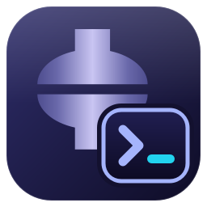

# AbaqusPythonReader

<p align="center">
  
</p>

<p align="center">
  
  
  
  
</p>

实时查看 Abaqus/CAE 命令流（`abaqus.rpy`）的桌面工具，用于 Abaqus 脚本开发和参数化建模。

## 功能

- Python 语法高亮，深色/浅色主题
- 隐藏视图操作（平移、旋转、缩放、fitView 等），复制和另存为时自动去除
- 只读轮询文件，不影响 Abaqus 写入
- 悬浮窗：置顶、透明度、无边框，右键拖动，边缘缩放
- 切换几何录制模式（坐标 / 索引 / 掩码），可写入用户目录的 `abaqus_v6.env` 设为启动默认

## 使用

从 [Releases](https://github.com/cxp1998/AbaqusPythonReader/releases) 下载 `AbaqusPythonReader.exe` 直接运行，或从源码启动（Python 3.10+）：

```bash
python -m venv .venv
.venv\Scripts\activate
pip install -r requirements.txt
python run.py
```

默认监控当前目录下的 `abaqus.rpy`，点击顶栏的文件名可更换。

开发、测试和打包见 [CONTRIBUTING.md](CONTRIBUTING.md)。

## 致谢

本项目重写自焦博士（[ck436@126.com](mailto:ck436@126.com)）2010 年开发的 ABAQUS-PythonReader。原版程序与源码保存在 [`legacy/`](legacy/)。

## 许可证

[MIT](LICENSE)
