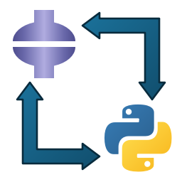

# PythonReader 2.0

<p align="center">
  
</p>

<p align="center">
  <strong>ABAQUS CAE Python 命令流实时监视与辅助工具</strong><br>
  <em>专为 ABAQUS 脚本二次开发、参数化建模与命令流学习量身打造的现代化 HUD 工具。</em>
</p>

<p align="center">
  
  
  
  
</p>

---

## 🌟 核心特性

- **原生 Python 语法高亮**：精准着色 Python 关键字、Abaqus API、内置函数、数字与字符串，支持深色/浅色主题自由切换。
- **智能视口冗余过滤**：自动/一键剔除平移（pan）、旋转（rotate）、缩放（zoom）、视图适应（fitView）等图形视口操作，保持命令流纯净精简。
- **零锁死安全读取**：底层采用非阻塞共享文件轮询机制，绝不与 Abaqus 进程发生写锁争用冲突。
- **现代轻量 HUD 交互**：
  - 支持右键在窗口任意位置自由拖拽移动。
  - 无边框模式下支持窗口边缘自由拉伸缩放。
  - 支持窗口全局置顶（Pin）、透明度自由调节（10% ~ 100%）。
- **统一矢量图标系统**：全界面采用高精度 Lucide 矢量图标，多分辨率视网膜屏幕高清显示不模糊。
- **Abaqus 录制模式一键配置**：
  - **坐标模式（COORDINATE / findAt 坐标）**：参数化建模推荐。
  - **索引模式（INDEX / 对象序号）**：网格与单元节点批处理首选。
  - **掩码模式（COMPRESSEDINDEX）**：Abaqus 默认内部格式。

---

## 📂 项目结构

```text
PythonReader/
├── .github/                  # GitHub Actions CI 与发布工作流
│   └── workflows/
│       ├── ci.yml            # 自动化跨版本测试
│       └── release.yml       # Release 打包发布流水线
├── examples/                 # 示例与演示脚本
│   └── sample_abaqus.rpy     # 典型 Abaqus 回放流测试样例
├── legacy/                   # 历史版本归档 (2010 年原版)
│   ├── PythonReader_2010.exe # 2010 原版经典可执行程序
│   └── csharp_v1/            # 原版反编译工程参考源码 (已清理编译垃圾)
├── python_reader/            # 核心应用源码
│   ├── resources/            # 图标与矢量资源
│   ├── abaqus_mode.py        # Abaqus 录制模式配置器
│   ├── app.py                # 主界面与 HUD 交互逻辑
│   ├── cleaner.py            # 命令流智能过滤与清理器
│   ├── config.py             # 配置管理与持久化
│   ├── editor.py             # 代码展示与行号编辑器组件
│   ├── file_monitor.py       # 非阻塞文件监控引擎
│   ├── highlighter.py        # Python 语法高亮与主题定义
│   └── icons.py              # 矢量图标渲染器
├── tests/                    # 单元测试套件
│   ├── test_cleaner.py       # 过滤逻辑单元测试
│   ├── test_config.py        # 配置读写单元测试
│   └── test_file_monitor.py  # 文件监控增量读取测试
├── CONTRIBUTING.md           # 开源贡献指南
├── LICENSE                   # MIT 开源许可证
├── pyproject.toml            # 现代 Python 项目元数据与打包规范
├── requirements.txt          # 核心运行依赖
├── requirements-dev.txt      # 开发与测试依赖
├── run.bat                   # Windows 便捷启动脚本
├── run.py                    # 应用程序启动入口
└── PythonReader_v2.spec      # PyInstaller 打包规格文件
```

---

## 🚀 快速上手

### 方式一：下载 Release 独立程序
前往 [GitHub Releases](https://github.com/example/PythonReader/releases) 页面，下载最新的 `PythonReader_v2.exe`，免安装即开即用。

### 方式二：从源码启动

```bash
# 1. 克隆代码仓库
git clone https://github.com/example/PythonReader.git
cd PythonReader

# 2. 创建并激活虚拟环境 (推荐 Python 3.10+)
python -m venv .venv
.\.venv\Scripts\activate

# 3. 安装依赖
pip install -r requirements.txt

# 4. 启动程序
python run.py
# 或直接双击运行 run.bat
```

---

## 🧪 运行测试

本项目配备完整的自动化单元测试：

```bash
# 使用内置 unittest 运行全部测试
python -m unittest discover tests

# 或者使用 pytest
pytest
```

---

## 📦 打包构建

若需自行构建单文件绿色版 Windows 可执行文件：

```bash
pip install -r requirements-dev.txt
pyinstaller PythonReader_v2.spec
```

编译生成的可执行程序位于 `dist/PythonReader_v2.exe`。

---

## 🤝 致谢与鸣谢 (Acknowledgments)

本项目源自并深度重构自经典工具 **ABAQUS-PythonReader (2010)**。

在此特别致敬原软件设计者与开发者：
- **原作者**：焦博士
- **联系邮箱**：[ck436@126.com](mailto:ck436@126.com)

衷心感谢焦博士在 2010 年首创研发的 PythonReader 工具与优秀的设计理念，为广大 ABAQUS 二次开发工程师与 Python 命令流学习者提供了卓越的启蒙与支持！原版程序与源码已妥善归档至 [`legacy/`](legacy/) 目录以示纪念。

---

## 📄 授权与许可

本项目基于 [MIT License](LICENSE) 许可协议开源发布。遵循原版开源分享精神，欢迎自由学习、研究与工程应用交流。
